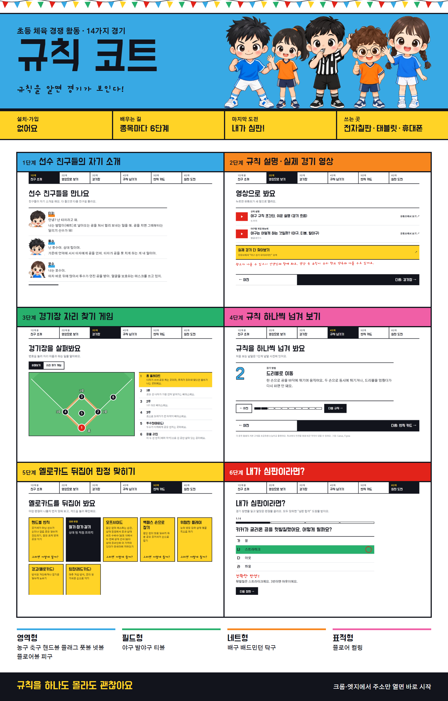

# 규칙 코트 · 초등 체육 경기 규칙 웹앱

규칙을 하나도 모르는 아이도 **14가지 경기의 규칙**을 처음부터 익힐 수 있는 웹앱이에요.
선수 캐릭터가 자기 소개를 하고, 영상으로 경기를 보고, 마지막에는 내가 심판이 되어 판정해요.

- **앱 열기**: https://jbhee7777-afk.github.io/rule-court/
- 설치도 가입도 없어요. 크롬·엣지에서 주소만 열면 돼요. 전자칠판, 태블릿, 휴대폰에서 쓸 수 있어요.

## 들어 있는 경기

| 유형 | 경기 |
|---|---|
| 영역형 | 농구, 축구, 핸드볼, 플래그 풋볼, 넷볼, 플로어볼, 피구 |
| 필드형 | 야구, 발야구, 티볼 |
| 네트형 | 배구, 배드민턴, 탁구 |
| 표적형 | 플로어 컬링 |

## 종목마다 6단계로 배워요

1. **친구 소개**: "안녕? 난 타자라고 해." 선수 캐릭터가 자기 역할을 말해 줘요. 어려운 낱말은 쉬운 낱말 사전으로 풀어 줘요.
2. **영상으로 보기**: 규칙 설명 영상과 실제 경기 영상을 유튜브로 열어요.
3. **경기장**: 번호를 눌러 자리를 익히고, 자리 찾기 게임을 해요.
4. **규칙 넘기기**: 경기 방법과 점수 내는 법을 한 장씩 넘겨 봐요.
5. **반칙 카드**: 옐로카드를 뒤집어 어떤 판정이 나오는지 맞혀요. 학교에서 바꿔 쓰는 약속도 있어요.
6. **심판 도전**: 경기 장면을 읽고 판정해요. 다 맞히면 "심판 합격" 도장을 받아요.

쉬는 시간 게임으로 **이 규칙, 어느 경기일까?**, **섞어서 심판 도전**도 있어요. 배울수록 심판 점수가 올라가요.

## 알아 두세요

- 규칙은 각 종목의 기본 규칙을 초등학생 눈높이로 줄인 것이에요. 학교마다 안전을 위해 바꾼 약속이 있을 수 있어요.
- 점수와 기록은 그 기기의 브라우저에만 저장돼요. 다른 곳으로 보내지 않아요.
- 영상은 유튜브에 공개된 영상을 링크로 연결한 것이고, 저작권은 각 채널에 있어요. 수업 전에 내용을 확인해 주세요.
- 그림은 Canva와 Figma로 만들었어요.

## 고치고 싶을 때

| 파일 | 내용 |
|---|---|
| `data1.js`, `data2.js` | 경기 규칙, 반칙, 학교 약속, 퀴즈 |
| `story1.js`, `story2.js` | 캐릭터 소개, 낱말 사전 |
| `videos.js` | 유튜브 영상 목록 |
| `courts.js` | 경기장 그림 |
